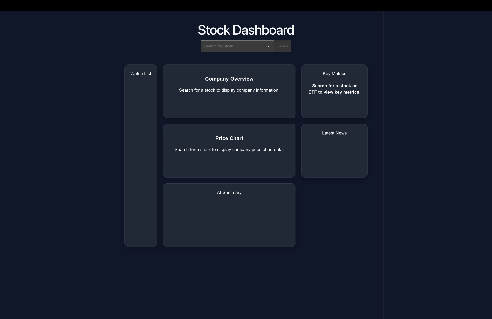
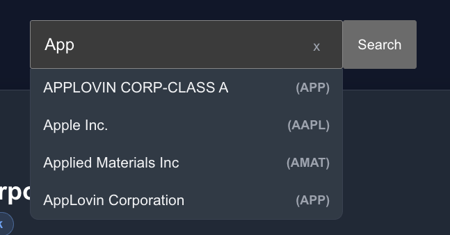
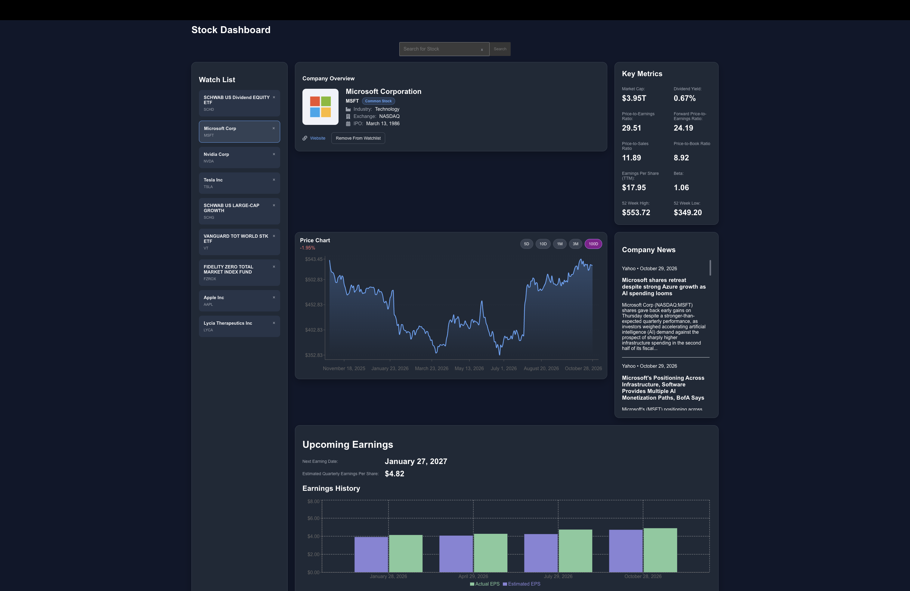

# Stock Dashboard

A full-stack financial research dashboard built with React, JavaScript, Python, and Flask. The application allows users to search for stocks, ETFs, and mutual funds, explore company information, key financial metrics, and historical price charts, financial news, and earnings data.

## Tech Stack

### Frontend
- React
- Vite
- JavaScript
- CSS
- Recharts

### Backend
- Python
- Flask
- Flask-CORS

### APIs
- Finnhub API
- Alpha Vantage API

## Screenshots

### Landing Page

### Search Suggestions

### Dashboard After Selecting a Stock

## Current Features

- Stock, ETF & Mutual Fund Search
- Search Suggestions
- Company & Fund Information
- Company Logos
- Key Financial Metrics
- Interactive Historical Price Charts (5D, 10D, 1M, 3M, 100D)
- Watchlist
- Latest Company News
- Upcoming Earnings
- Backend API Caching
- Error Handling
- Loading States

## Planned Features

- AI Stock Summaries
- AI Stock Comparisons
- Portfolio Insights

## Status

🚧 Active Development
